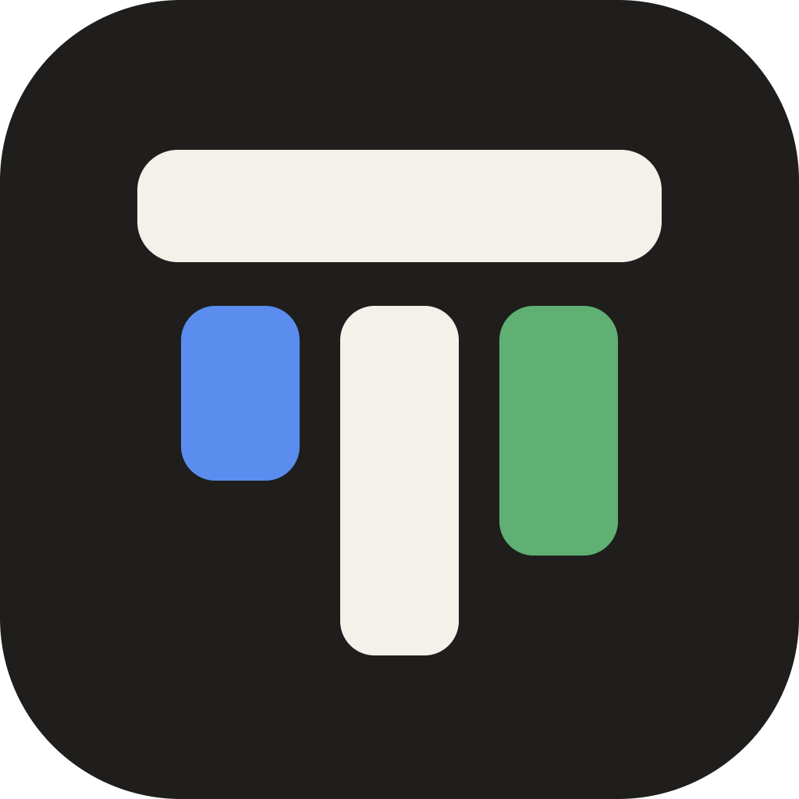
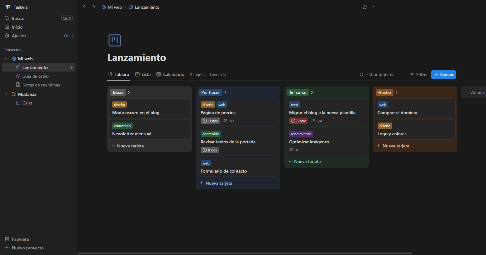
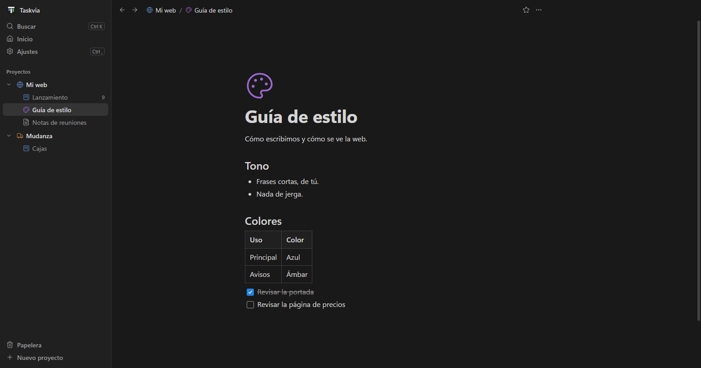

<p align="center"></p>

<h1 align="center">Taskvia</h1>

<p align="center">Tus proyectos en local: tableros kanban y páginas de documentación,<br>con un servidor MCP para trabajarlos a medias con tu asistente de IA.</p>





Taskvia pone en orden las tareas, la documentación y lo que la IA va haciendo en cada proyecto. Todo se queda en tu disco, en ficheros que puedes abrir sin la app.

## Qué tiene

**Tableros (un kanban para una persona)**
- Columnas que se arrastran, se pliegan, se copian y se ordenan (por vencimiento, título o antigüedad).
- Tarjetas con:
  - descripción con formato, etiquetas de color, fechas de inicio y vencimiento (en rojo si vencen, en verde si están hechas);
  - varias checklists, adjuntos (ficheros y enlaces), portada de color o de imagen, icono;
  - notas de trabajo e historial de cambios.
- Vistas **Tablero**, **Lista** y **Calendario**; filtros por texto, etiqueta y fecha.
- Plantillas de tarjeta, copiar o mover tarjetas a otro tablero (o proyecto), archivar en vez de borrar, fondo del tablero y duplicar tableros.
- Atajos de teclado (pulsa `?` para verlos).

**Documentación (editor por bloques)**
- Páginas con subpáginas, escritas como en un procesador de texto y guardadas como markdown.
- Barra flotante al seleccionar texto (o fija, si la prefieres), menú `/` para insertar bloques y subpáginas, y `[[` para enlazar páginas.
- Imágenes pegadas o arrastradas. Cada página muestra quién la enlaza.

**Con tu IA (MCP)**
- Pega una tarea de cualquier herramienta y di *«vamos con esto en el tablero Sprint de Mi app»*. La IA crea la tarjeta con su checklist, la mueve mientras trabaja, va marcando pasos, deja notas de lo hecho y lo que falta, y documenta en las páginas del proyecto.
- Lo que hace la IA aparece en la app al momento. Si cambia algo que estás escribiendo, la app te avisa en vez de pisarlo.

**Que no se pierda nada**
- Papelera de 30 días con «Deshacer».
- Copia de seguridad diaria (se guardan 14).
- Datos en ficheros normales: JSON para los tableros, markdown para las páginas.

## Instalar

**Windows:** descarga `Taskvia-Setup-x.y.z.exe` de la [última versión](https://github.com/RubenMRDev/taskvia/releases/latest) y ábrelo. Se actualiza sola cuando sale una versión nueva (o al momento desde Ajustes → Actualizaciones → Buscar actualizaciones). Al no estar firmado, Windows puede avisar la primera vez: «Más información» → «Ejecutar de todas formas».

La primera vez se abre con un proyecto de ejemplo, «Bienvenida», que enseña lo básico. Bórralo cuando quieras.

**Desde el código** (cualquier sistema; hace falta [Node.js](https://nodejs.org) 22 o superior):

```bash
git clone https://github.com/RubenMRDev/taskvia.git
cd taskvia
npm install
npm start
```

Si `npm install` no descarga Electron (npm 11 puede saltarse su script): `node node_modules/electron/install.js`.

## Conectar con tu IA

En la app: **Ajustes → IA → Copiar configuración**, pégala en la configuración MCP de tu asistente y reinícialo. Ya lleva las rutas de tu equipo (con la app instalada no hace falta Node).

A mano, desde el código, cualquier cliente MCP puede lanzarlo por stdio con `node /ruta/a/taskvia/mcp.js`:

```json
{ "mcpServers": { "taskvia": { "command": "node", "args": ["/ruta/a/taskvia/mcp.js"] } } }
```

Herramientas que recibe la IA:
- **Proyectos y tableros:** `project_list`, `project_create`, `board_create`, `board_get`, `column_create`
- **Tarjetas:** `card_create`, `card_get`, `card_update` (también fechas), `card_move`, `card_copy`, `card_archive`, `card_delete`, `card_note`, `card_search`, `card_attach_link`, `checklist_add`, `checklist_update`
- **Páginas:** `doc_list`, `doc_read`, `doc_write`, `doc_delete`, `doc_search`
- **Papelera:** `trash_list`, `trash_restore`

## Dónde están tus datos

| Sistema | Carpeta |
|---|---|
| Windows | `%APPDATA%\Taskvia\datos` |
| macOS | `~/Library/Application Support/Taskvia/datos` |
| Linux | `~/.local/share/Taskvia/datos` |

Se puede cambiar con la variable `TASKVIA_DIR`. Dentro:
- `projects/<Proyecto>/boards/*.json` — los tableros;
- `projects/<Proyecto>/docs/**/*.md` — las páginas;
- `projects/<Proyecto>/assets/` — imágenes y adjuntos;
- `trash/` — la papelera;
- `backups/<fecha>/` — las copias;
- `settings.json` — los ajustes.

Para restaurar una copia: cierra la app y copia `backups/<fecha>/projects` sobre `projects`.

## Desarrollo

| Fichero | Qué es |
|---|---|
| `store.js` | Todos los datos en disco |
| `mcp.js` | Servidor MCP |
| `ui.js` | Servidor local de la interfaz (`TASKVIA_PORT`, 4545 por defecto) |
| `main.js`, `preload.cjs` | Ventana de Electron, tema nativo, copias diarias, actualizaciones |
| `ejemplo.js` | Proyecto «Bienvenida» del primer arranque |
| `public/` | La interfaz: `index.html`, `app.css` y `js/` (`state`, `sidebar`, `views`, `board`, `peek`, `editor`, `extras`, `popovers`, `menus`, `settings`, `app`) |
| `tools/icono.mjs` | Genera `build/icon.png` e `icon.ico` desde `public/icon.svg` (`npm run icono`) |

- `npm test` — datos y MCP.
- `npm run dist` — genera el instalador en `dist/`; `npm run release` además lo sube a una release de GitHub (necesita `GH_TOKEN`).
- `npm run test:ui` — abre la app con datos de prueba y recorre las [historias de usuario](HISTORIAS.md) con ratón y teclado.

## Licencia

[MIT](LICENSE)
